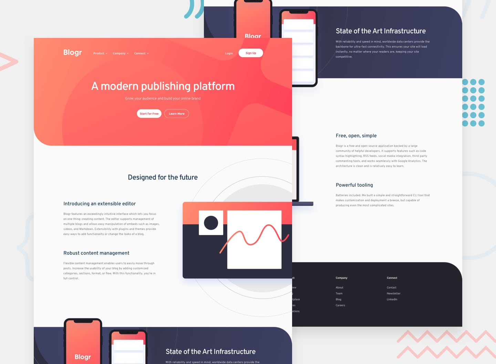

# Frontend Mentor - Blogr landing page

## Overview

This is my solution to the [Blogr landing page challenge on rontend Mentor](https://www.frontendmentor.io).

This is a fully responsive landing page for the Blogr. It features a mobile menu for mobile users and some dropdown features to show normally hidden section.

## The challenge

The goal was to build the landing page as close as possible to the given design while making the layout responsive accross different devices based on device size.

The users are able to:

* View the best layout of the page depending on their device's screen size
* See hover states for all interactive elements
* Open and close the menu on smaller device screens(mobile devices)

## Built with

* Semantic HTML5
* CSS custom properties
* CSS Flexbox
* Responsive design
* JavaScript

## What I learned

The project pushed me in a lot of way's I never exptected it to ever push me, just when I thought my css skill could grow no further this css project proved that wrong.

Some of the things I practiced were: 

* Building responsive layouts that change significantly between mobile and desktop
* Working with two columns that have roughly the same size, while it might sound simple, it's a layout I don't work with much, so it's very much lacking in that department — this project forced me to get comfortable with it
* Letting images bleed outside their containers using position: absolute plus overflow-x: clip, instead of shrinking them to fit
* Adding hover states to interactive elements
* Using JavaScript to control the mobile navigation menu

## Continued development

I would like to continue improving my JavaScript and accessibility knowledge. I would also like to refactor parts of the CSS in the future to make the code more maintainable as the project grows.

## Author

* Frontend Mentor - [@madalav549](https://www.frontendmentor.io/profile/madalav549)
* GitHub - [@madalav549](https://github.com/madalav549)